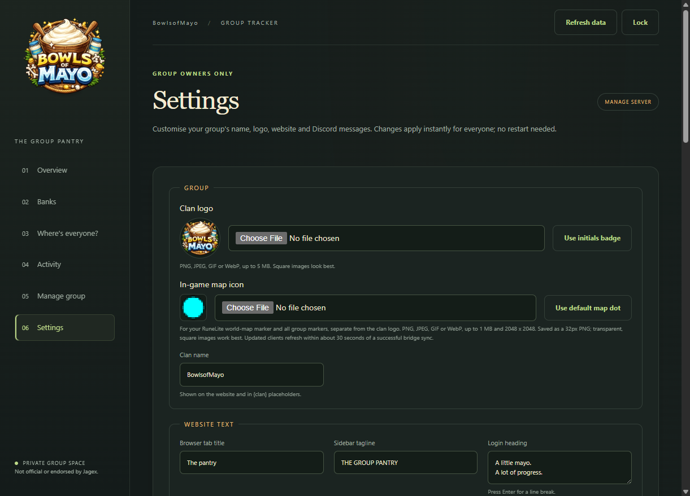
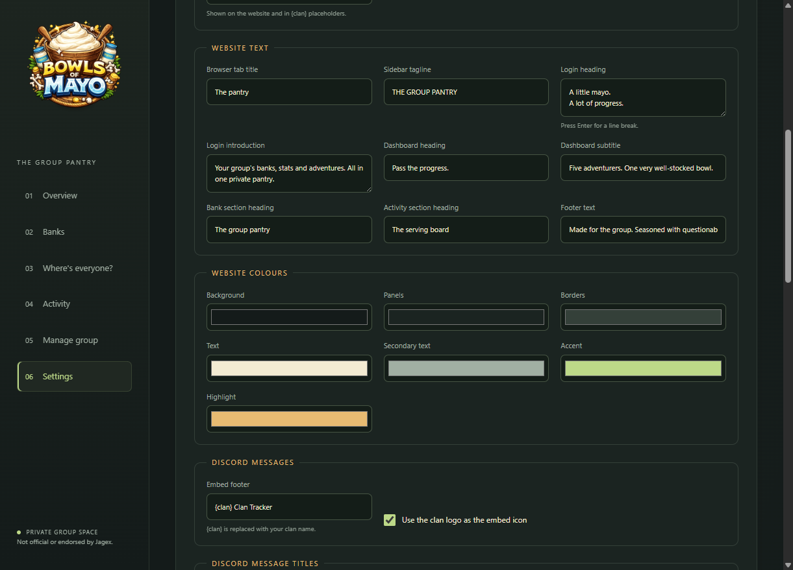
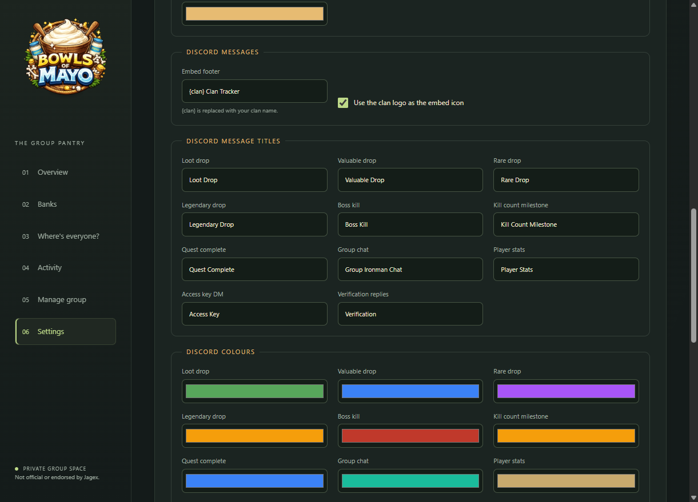
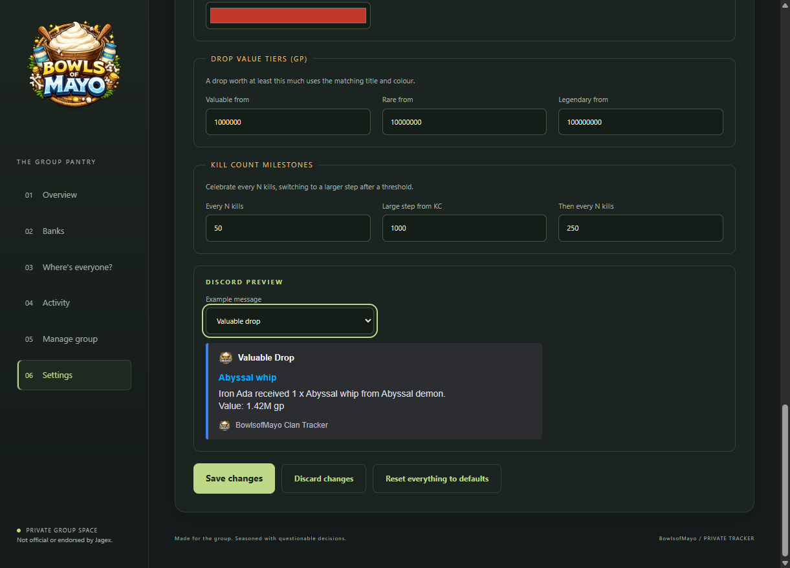
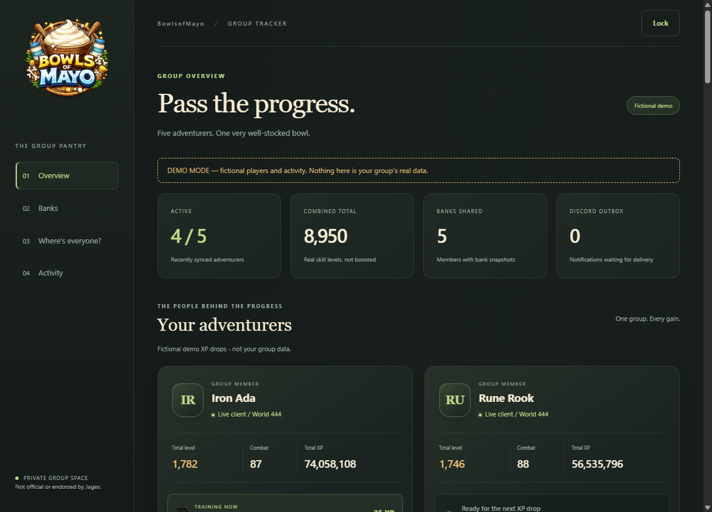
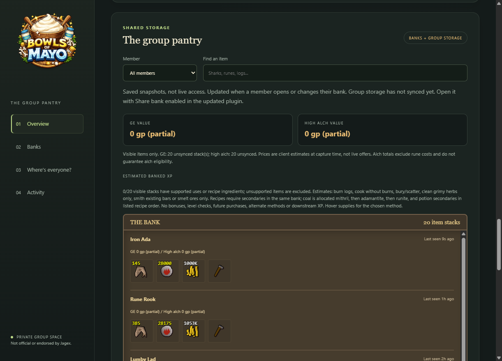
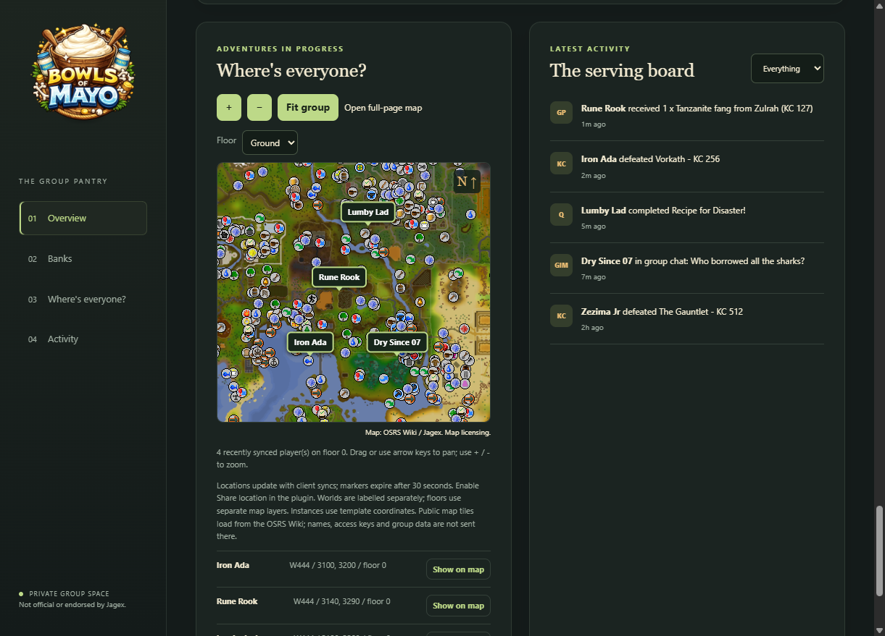
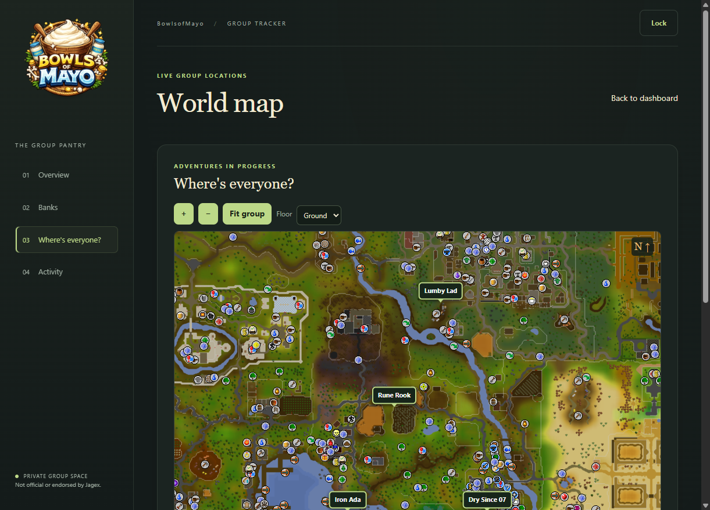

# Group Iron Companion

An opt-in RuneLite plugin for Group Ironman tracking, with a self-hosted web
dashboard and Discord bot.

This is an independent project and is not affiliated with Jagex or RuneLite.

Created using intellectual property belonging to Jagex Limited under the terms
of Jagex's Fan Content Policy. This content is not endorsed by or affiliated
with Jagex.

The BSD 2-Clause license applies only to original project code. Jagex-owned
images and other third-party materials are not covered and remain subject to
their respective terms.

## What it includes

- **RuneLite plugin:** share selected game data with your group's server.
- **Web dashboard:** view member stats, banks, activity and locations; manage
  group access and customise the panel.
- **Discord bot:** verify the group owner, issue access and receive opt-in
  game-event alerts.

## Screenshots

Settings page:

| Group and website | Website colors | Discord message styles | Preview and save |
| --- | --- | --- | --- |
|  |  |  |  |

Fictional demo:

| Overview | Banks | Locations and activity | Full-page map |
| --- | --- | --- | --- |
|  |  |  |  |

## Quick start

Each group hosts its own backend and Discord bot. The host needs Node.js 22 or
newer; Java 11 or newer is only needed to build the plugin.

1. In `backend`, install dependencies and create the private configuration files:

   ```powershell
   Set-Location backend
   npm ci
   Copy-Item .env.example .env
   Copy-Item members.example.json members.json
   Copy-Item branding.example.json branding.json
   ```

2. Create a Discord bot with **Message Content Intent** and **Server Members
   Intent** enabled. Invite it to a private channel, add the owner's Discord user
   ID to `members.json`, and set the bot token, server ID and channel ID in `.env`.
   The owner needs **Manage Server** permission.
3. Start the backend from `backend`:

   ```powershell
   npm start
   ```

4. In the configured Discord channel, the owner runs `!verify` and receives a
   private key by DM. Enter it on the web panel, then use **Manage group** to
   create a separate character token for each player.
5. In RuneLite, enable **Group Iron Companion**, set the backend URL and the
   player's token. Read and accept the connection consent, then enable only the
   sharing options you want.

Use the web panel to view shared group data and manage members/settings. The bot
posts enabled game alerts to its configured Discord channel; authorized Discord
users can use `!stats <player>` for the latest synced stats.

Local use defaults to `http://localhost:4000`. Remote plugin connections require
HTTPS; provide TLS through your hosting platform or another HTTPS front end, and
keep the backend listener private. Keep `.env`, `members.json`, `branding.json`
and `backend/data` private. Share each character token only with its intended
player, and never share the owner key.

## Development

Build and check the plugin, then run the backend tests:

```powershell
.\gradlew.bat jar verifyFeatures
Set-Location backend
npm ci
npm test
```

To preview the website with fictional data, run `npm run preview` from `backend`
and open `http://127.0.0.1:4173`. The preview does not use real group data or send
Discord notifications.
